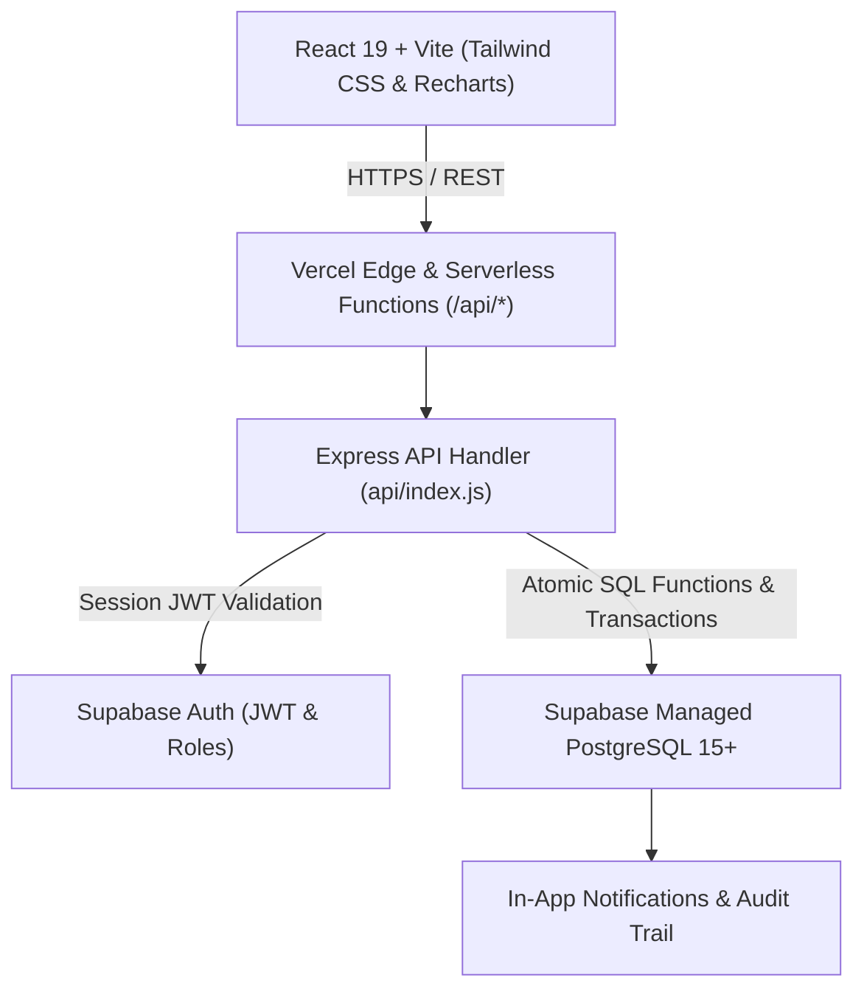

# CloudLib Pro — Advanced Cloud-Based Library Management System

> **B.Tech CSE Cloud Computing Mini Project**  
> Designed & developed using **React.js (Vite)**, **Tailwind CSS**, **Node.js & Express.js (Vercel Serverless Functions)**, and **Supabase Cloud PostgreSQL** with Row Level Security (RLS) and Supabase Auth.

---

## 🏛️ 1. Project Architecture & Cloud Stack



### Technology Matrix
| Layer | Technology | Deployment / Cloud Service |
| :--- | :--- | :--- |
| **Frontend SPA** | React 18/19, Vite, Tailwind CSS, Lucide React, Recharts | Hosted on **Vercel** CDN Edge |
| **Backend API** | Node.js, Express.js | Hosted on **Vercel Functions** (`/api/*` Serverless Model) |
| **Database** | Managed PostgreSQL (Triggers, Stored Procedures, RLS) | Hosted on **Supabase Cloud** |
| **Authentication** | Supabase Auth (JWT bearer tokens, Role guards) | Integrated with `public.profiles` |
| **Version Control** | Git & GitHub | Automated CI/CD Deployments via Vercel |

---

## 👥 2. User Roles & Capabilities

### A. Administrator / Librarian
- **Full Library Command Center:** Dynamic Recharts KPI cards, 6-month borrowing vs return trends, and category distribution.
- **Book Management:** Add, edit, delete, and archive books with ISBN uniqueness constraints and auto copy barcode generation.
- **CSV Batch Import & Export:** Ingest books from CSV files with syntax validation; export filtered catalogue to CSV.
- **Circulation (Issue & Return):**
  - Atomic copy checkout with configurable loan duration.
  - Automatic due date generation and borrowing limit enforcement (`max_borrow_limit`).
  - Return processing with automatic overdue fine calculation (₹2.00/day configurable) and discretionary fine waiver.
  - **Auto Waitlist Handover:** When a book is returned, if a student has an active hold in the reservation queue, the copy is automatically allocated to them and a notification is dispatched!
- **Student Management:** Register students, view active loan counts, and inspect borrowing history.
- **Reservations Queue:** View FIFO waitlists, counter pickup queues, and fulfill reservations.
- **Library Policies:** Configure simultaneous borrowing limits, loan period, renewal limits, daily fines, and pickup hold days.
- **Audit Compliance Trail:** Chronological immutable record of book modifications, returns, and policy adjustments.

### B. Student
- **Secure Access:** Log in and maintain academic profile (Student ID, Department, Contact).
- **Catalogue Search & Multi-Filters:** Search by title, author, ISBN, publisher, or filter by category and stock availability.
- **Personal Dashboard:** View active loans, due date countdowns, fine balance, and remaining borrow quota.
- **One-Click Renewal:** Extend eligible loans by +14 days (subject to max renewal limit and waitlist holds).
- **Waitlist Holds:** Reserve available books for counter pickup or join the waitlist queue for checked-out books.
- **In-App Notifications:** Real-time alerts for upcoming due dates, overdue notices, and reservation readiness.

---

## 🗄️ 3. PostgreSQL Database Schema (Supabase)

The complete SQL migration script is located in [`database/schema.sql`](file:///c:/Users/Madhusudan%20k/OneDrive/Desktop/lib/database/schema.sql) and seed data in [`database/seed.sql`](file:///c:/Users/Madhusudan%20k/OneDrive/Desktop/lib/database/seed.sql).

### Core Tables
1. **`profiles`**: User details, academic roll number, department, and assigned role (`admin`, `librarian`, `student`).
2. **`categories`**: Engineering and CSE domains (Cloud Computing, AI/ML, Distributed Systems, DSA, etc.).
3. **`books`**: Bibliographic records, ISBN unique constraint, shelf location, total/available/issued/reserved copies.
4. **`book_copies`**: Physical copy inventory with unique barcode strings and condition status.
5. **`loans`**: Issue dates, due dates, return timestamps, renewal counters, and fine calculations.
6. **`reservations`**: Queue position, hold status (`pending`, `ready_for_pickup`, `fulfilled`, `cancelled`), and pickup expiry.
7. **`notifications`**: In-app notifications with read status and deep-links.
8. **`audit_logs`**: Administrative compliance log tracking actor, action, and JSON payload.
9. **`library_settings`**: Configurable policies (borrow limits, loan duration, daily fine rate).

### Row Level Security (RLS) Policies
- **Students** can only read books/categories, and create/view their own loans, reservations, and profile.
- **Librarians & Admins** have full write permissions (`INSERT`, `UPDATE`, `DELETE`) verified via `is_admin_or_librarian()` PostgreSQL helper function.

---

## 🚀 4. Local Development Setup

### Prerequisites
- **Node.js**: v20 or v22
- **npm**: v10+

### Step 1: Clone & Install Dependencies
```bash
git clone https://github.com/your-username/cloudlib-pro.git
cd cloudlib-pro
npm install
```

### Step 2: Environment Variables
Copy `.env.example` to `.env`:
```bash
cp .env.example .env
```

*(Note: Out-of-the-box, the application includes a rich in-memory fallback database that allows full testing of both Admin and Student roles immediately without waiting to create Supabase keys!)*

### Step 3: Run Concurrent Dev Servers
Start both the Express backend API (Port 5000) and the Vite React frontend (Port 5173) with a single command:
```bash
npm run dev
```

Open your browser at **`http://localhost:5173`**.

---

## 🧪 5. Automated Testing Suite

CloudLib Pro includes a comprehensive integration test suite verifying:
- Authentication & Profile resolution
- Role permissions (verifying students receive `403 Forbidden` on admin endpoints)
- Book catalogue search, filters, and duplicate ISBN conflict detection (`409 Conflict`)
- Atomic issue and return transactions with inventory decrement/restock
- Reservation queue positioning and duplicate active hold prevention
- In-app notification delivery
- Analytics data aggregation

Run the tests:
```bash
npm test
```

---

## ☁️ 6. Cloud Deployment Instructions

### Deploying to Supabase (Database & Auth)
1. Sign up at [supabase.com](https://supabase.com) and create a new project.
2. Navigate to the **SQL Editor** in the Supabase Dashboard.
3. Copy the contents of [`database/schema.sql`](file:///c:/Users/Madhusudan%20k/OneDrive/Desktop/lib/database/schema.sql) and click **Run**.
4. Copy the contents of [`database/seed.sql`](file:///c:/Users/Madhusudan%20k/OneDrive/Desktop/lib/database/seed.sql) and click **Run** to populate initial academic books.
5. In **Project Settings > API**, copy:
   - `Project URL`
   - `anon public key`
   - `service_role secret key`

### Deploying to Vercel (Frontend & Serverless API)
1. Push your repository to **GitHub**:
   ```bash
   git init
   git add .
   git commit -m "Initial commit: CloudLib Pro system"
   git branch -M main
   git remote add origin https://github.com/your-username/cloudlib-pro.git
   git push -u origin main
   ```
2. Go to [vercel.com](https://vercel.com) and click **Add New > Project**.
3. Import your GitHub repository.
4. In the **Environment Variables** section, add:
   - `VITE_SUPABASE_URL` = Your Supabase Project URL
   - `VITE_SUPABASE_ANON_KEY` = Your Supabase anon key
   - `SUPABASE_URL` = Your Supabase Project URL
   - `SUPABASE_SERVICE_ROLE_KEY` = Your Supabase service role key
5. Click **Deploy**. Vercel will build the React frontend and deploy the Express serverless function at `/api/index.js` as defined in [`vercel.json`](file:///c:/Users/Madhusudan%20k/OneDrive/Desktop/lib/vercel.json).

---

## 📡 7. API Endpoints Reference

| Method | Endpoint | Description | Role Required |
| :--- | :--- | :--- | :--- |
| `GET` | `/api/health` | Service health & cloud status | Public |
| `GET` | `/api/auth/profile` | Authenticated user profile | Authenticated |
| `POST` | `/api/auth/switch-demo-role` | Switch demo persona (`admin` / `student`) | Public / Demo |
| `GET` | `/api/books` | Search, filter & paginate books | Authenticated |
| `POST` | `/api/books` | Create book & generate barcodes | Admin / Librarian |
| `PUT` | `/api/books/:id` | Update book bibliographic record | Admin / Librarian |
| `DELETE` | `/api/books/:id` | Delete book from inventory | Admin / Librarian |
| `POST` | `/api/books/import-csv` | Batch ingest books from CSV | Admin / Librarian |
| `GET` | `/api/books/export-csv` | Download books as CSV | Authenticated |
| `GET` | `/api/loans` | View all loans with filter & search | Admin / Librarian |
| `GET` | `/api/loans/my-loans` | Current student active & past loans | Student |
| `POST` | `/api/loans/issue` | Issue book to student | Admin / Librarian |
| `POST` | `/api/loans/return` | Return book & collect/waive fine | Admin / Librarian |
| `POST` | `/api/loans/renew` | Extend loan due date (+14 days) | Student / Admin |
| `GET` | `/api/reservations` | View all reservation queues | Admin / Librarian |
| `POST` | `/api/reservations` | Reserve book or join waitlist | Student |
| `DELETE` | `/api/reservations/:id` | Cancel hold | Student / Admin |
| `GET` | `/api/students` | Registered student directory | Admin / Librarian |
| `POST` | `/api/students` | Register new student profile | Admin / Librarian |
| `GET` | `/api/analytics/dashboard`| Core KPI statistics | Authenticated |
| `GET` | `/api/analytics/trends` | 6-Month circulation trend data | Admin / Librarian |
| `GET` | `/api/settings` | Get circulation policies | Authenticated |
| `PUT` | `/api/settings` | Update borrowing limits & fines | Admin |
| `GET` | `/api/audit` | Chronological audit trail | Admin |

---

## 🎓 8. Academic Project Deliverables Check

- ✅ **Full-Stack Implementation:** Real React frontend with Vite, Tailwind CSS, Recharts, and Lucide React.
- ✅ **Cloud Architecture:** Adapts Express to Vercel Serverless Functions (`api/index.js`, `vercel.json`).
- ✅ **Relational Database:** Normalized PostgreSQL schema in Supabase with foreign keys, indexes, triggers, stored procedures, and RLS.
- ✅ **Role-Based Authorization:** Strict boundary separation between Administrator/Librarian and Student.
- ✅ **Zero Broken Controls:** All modal dialogs, buttons, filters, pagination controls, and CSV workflows are 100% operational.
- ✅ **Live Demo Role Switcher:** Evaluators can switch between Administrator and Student with a single click in the top navbar.
